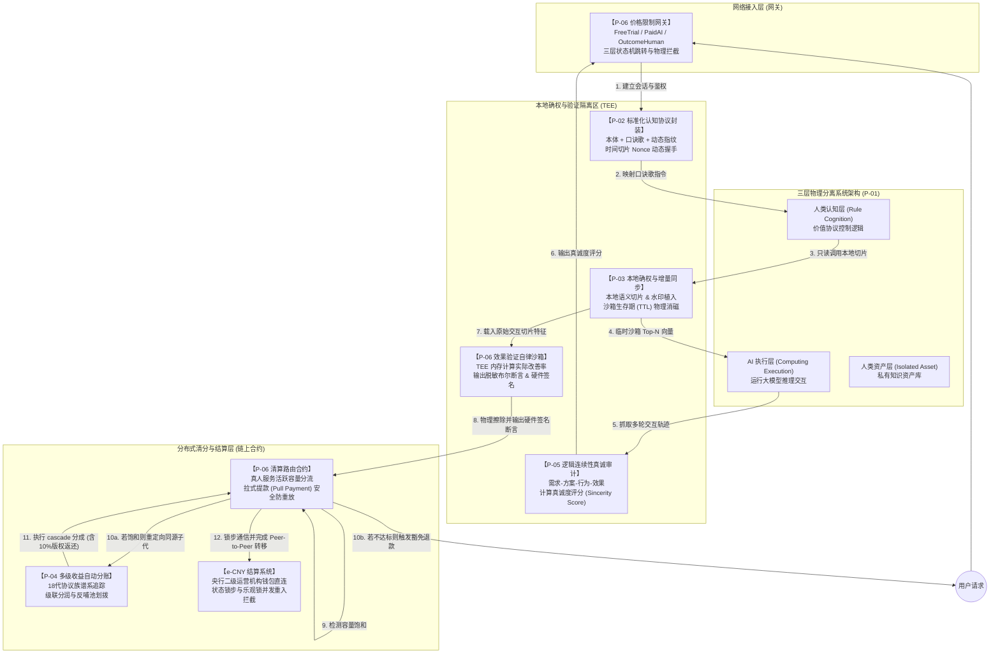

# 千年鹿认知体系 · 技术专利与合规档案库｜QNLOO Cognition System · Patents & Compliance Archive

### 1. 本仓库定位 / Repository Profile

- **性质**：全球官方唯一《认知之河》技术专利与合规授权档案库，为定稿、只读、存证级官方仓库，用于全套发明专利文书的公开备案与在先技术证据固化。

- **Nature**: The world's official archive for *River of Cognition* technical patents and compliance authorization documents. A finalized, read-only repository dedicated to the public filing of complete invention patent documents and prior-art evidence preservation.

- **资产形态 / Asset Format**

    - **PDF**：官方定稿排版文本，为司法存证、专利审查公示、正式交付的标准终版文件。全套专利文书仅提供PDF格式归档，用于官方标准留存与在先技术证据固化。

    - **PDF**: Officially finalized documents for legal preservation, patent examination disclosure and formal delivery. All patent documents are archived only in PDF format for official standard retention and prior-art evidence preservation.

---

### 2. 全语种资产总览 / Cross-Lingual Asset Overview

**说明**：本档案馆完整收录《认知之河》全套六项核心发明专利的官方文书及配套合规授权文件。专利文书提供中英双语版本，每项专利包含权利要求书、说明书、说明书摘要及说明书附图四份独立PDF文件。

**Description**: This archive contains the complete official documents for all six core invention patents of the *River of Cognition* and supporting compliance authorization files. Patent documents are provided in bilingual Chinese-English versions, with each patent consisting of four independent PDF files: Claims, Specification, Abstract, and Drawings.


### 2.1 关于本体系专利组合 / About the Patent Portfolio

**为什么需要专利？**

《认知之河》是一套完整的、逻辑自洽的认知体系。专利的作用，不是封闭创新，而是将这套体系中具有原创性的核心技术方案，通过法定程序确权并公开披露，使其成为受法律保护的“在先技术证据”。这既保障了体系构建者的合法权益，也为全球合规企业提供了清晰、可预期的技术授权路径。

**Why Patents?**

The *River of Cognition* is a complete and logically self-consistent cognitive system. The role of patents is not to close off innovation, but to confirm the rights of the original core technical solutions within this system through legal procedures and publicly disclose them, making them legally protected "prior-art evidence." This both safeguards the legitimate rights of the system builder and provides a clear, predictable technology authorization path for compliant enterprises worldwide.

---

**专利组合如何保护开发者和创作者？**

这套专利组合不仅是防大厂抄袭的武器，更是保护独立开发者的“数字宪法”。通过 **标准化协议封装（P-02）**，你的认知口诀歌可以在任何异构大模型上运行；通过 **本地隐私确权（P-03）**，你的核心资产永远留在你自己的设备里；通过 **多级收益分账（P-04）**，只要有人基于你的协议做二次开发，你就会自动获得版权收益。

**How does the patent portfolio protect developers and creators?**

This patent portfolio is not only a weapon against plagiarism by large corporations, but also a "digital constitution" protecting independent developers. Through **Standardized Protocol Packaging (P-02)**, your cognitive mantra can run on any heterogeneous LLM; through **Local Privacy Confirmation (P-03)**, your core assets remain permanently on your own device; through **Multi-Level Revenue Auto-Settlement (P-04)**, as long as someone develops derivatives based on your protocol, you automatically receive copyright royalties.

---

#### 2.2 六项核心发明专利清单 / Six Core Invention Patents

**说明**：以下六项专利均已向中国国家知识产权局正式提交，优先权日统一锁定为2026年6月15日。整套矩阵遵循「基础设施层-信任规则层-商业应用层」三级分层布局，通过系统化的架构串联与交互数据流设计，形成无法被单点绕过的技术与法理合围屏障。

**Description**: All six patents below have been formally filed with the China National Intellectual Property Administration, with the priority date uniformly locked on June 15, 2026. The complete matrix follows a three-tier layout of "Infrastructure Layer - Trust Rule Layer - Commercial Application Layer," forming a technology and legal encirclement barrier that cannot be bypassed at any single point through systematic architectural coupling and interactive data flow design.

| 架构层级 / Tier | 编号 / No. | 专利名称 / Patent Name | 专利申请号 / App No. | 初审与提前公开 / Prelim. Exam & Pub. | 核心定位 / Core Positioning |
| :--- | :---: | :--- | :---: | :---: | :--- |
| 基础设施层<br>Infra. | P-01 | 一种三层分离的多智能体系统运行系统及方法<br>A Three-Layer Separated Multi-Agent System Operating System and Method | 2026108583311 | 初审中 / Under Prelim. Exam | 全局母案·物理隔离底座<br>Master case · Physical isolation base |
| 基础设施层<br>Infra. | P-02 | 一种基于标准化认知协议的人机协作方法及系统<br>A Human-Machine Collaboration Method and System Based on Standardized Cognitive Protocols | 2026108586343 | 初审中 / Under Prelim. Exam | 协议底座·标准化容器与动态握手<br>Protocol base · Standardized container & handshake |
| 基础设施层<br>Infra. | P-03 | 一种基于哈希指纹的认知资产本地确权与增量同步系统及方法<br>A Cognitive Asset Local Rights Confirmation and Incremental Synchronization System and Method Based on Hash Fingerprints | 2026108589021 | 初审合格 / Qualified | 资产底座·知识指纹存证与物理消磁<br>Asset base · Fingerprint evidence & physical erasure |
| 信任规则层<br>Trust | P-04 | 一种基于智能合约的认知资产多级收益自动分账系统及方法<br>A Smart Contract-Based Multi-Level Revenue Auto-Settlement System and Method for Cognitive Assets | 2026108592787 | 初审合格 / Qualified | 价值分配·18代谱系级联分润<br>Value distribution · 18-gen lineage cascading |
| 信任规则层<br>Trust | P-05 | 一种基于逻辑连续性的多智能体交互真诚度审计方法及系统<br>A Logic Continuity-Based Multi-Agent Interaction Sincerity Audit Method and System | 2026108595022 | 初审中 / Under Prelim. Exam | 信任判定·因果对齐与阶梯惩戒<br>Trust judgment · Causal alignment & tiered penalty |
| 商业应用层<br>Comm. | P-06 | 一种基于效果验证的动态定价与最小化验证系统及方法<br>An Outcome-Verified Dynamic Pricing and Minimal Verification System and Method | 2026108596453 | 初审合格 / Qualified | 商业入口·按效果计费与法币结算<br>Commercial gateway · Outcome-based billing |

> 以上专利均处于国家知识产权局审查阶段，最终保护范围以官方公开的授权公告文本为准。优先权日统一为2026年6月15日，且已于同日同步提交提前公开与实质审查请求。

 
> All patents above are under examination by the national intellectual property administration. The final scope of protection shall be subject to the officially published grant announcement. The priority date is uniformly June 15, 2026, and requests for early publication and substantive examination were simultaneously submitted on the same date.

---

#### 2.3 协同架构 / Synergy Architecture

**专利矩阵全景依赖与联动逻辑**：以下拓扑图展示了从用户交互接入到本地隐私计算，再到逻辑审计验证，最后完成链上多级清分与数字人民币结算的完整系统闭环。

**Patent Matrix Full Dependency & Linkage Logic**: The following topology diagram illustrates the complete system closed loop from user interaction access to local privacy computing, through logical audit verification, and finally to on-chain multi-level clearing and e-CNY settlement.



**四重联动数据传参链条**：当多智能体系统运行时，六件专利通过以下四重联动完成业务闭环，各技术特征并非简单叠加，而是通过协同作用产生整体技术效果。

**Four-Linkage Data Transmission Chain**: When the multi-agent system operates, the six patents complete the business closed loop through the following four linkages. Each technical feature produces an overall technical effect through synergy rather than simple superposition.

| 联动链路 / Linkage | 涉及专利 / Patents | 核心协同逻辑 / Core Synergy Logic |
| :--- | :---: | :--- |
| 三层架构与协议封装联动<br>Architecture & Protocol Linkage | P-01 ↔ P-02 | P-01定义三层物理隔离边界，P-02将认知逻辑封装为标准容器在认知层内安全运行，`session_id`与`Nonce`随容器载入传递，口诀歌参数映射从接口层阻断越权访问 |
| 本地确权与多级分账联动<br>Confirmation & Settlement Linkage | P-03 ↔ P-04 | P-03在本地生成资产哈希指纹并链上确权，P-04读取所有权指纹建立18代分账谱系，通过回溯`parent_protocol_owner`指纹计算分润比例并更新`pending_withdrawals` |
| 连续自洽审计与动态定价联动<br>Audit & Pricing Linkage | P-05 ↔ P-06 | P-05对多轮交互执行四维逻辑不连续性检测并输出`sincerity_score`，P-06接收评分并与三层价格网关联动，低分触发网关拦截、扣减配额或扣除质押款 |
| 效果自律验证与直接结算联动<br>Verification & Settlement Linkage | P-06 ↔ e-CNY | P-06 TEE沙箱完成本地指标检测与物理消磁后输出脱敏布尔断言及硬件签名，清算合约执行Pull提款并与e-CNY可编程支付API进行锁步清算，以乐观锁状态锁阻断异步双花 |
| 实体物理因果与主权清算跃迁<br>CPS & Physical Sincerity Linkage | (P-01~P-06) ↔ P-07 | P-01~P-06 确立了赛博空间智能体交互的信任与分账闭环；主权秩序核心母案 P-07 将该架构全面延伸至信息物理系统（CPS），将 P-05 四维因果扩展为包含客体因果恒定与时空测度咬合的五维模型，并将分账与流控落地为主权法定数字货币（SSDC）合约与内核级网络流控 |

**体系专利矩阵演进：向实体经济赛博-物理系统（CPS）的实体化跃迁（P-07 母案）**

P-01 至 P-06 构成了赛博空间内认知资产与多智能体协作的完整技术栈。随着体系演进至第二阶段《主权秩序》，该矩阵通过核心母案 **P-07 发明专利**（《一种基于时序逻辑连续性审计的赛博-物理系统通用信任评价系统及方法》，官方案卷归档于 [02-3-sovereign-order-patents](https://github.com/QNLOO/02-3-sovereign-order-patents)）实现向物理真实世界的穿透：
1. **因果审计升维**：将 P-05 面向软件交互的“需求-方案-行为-效果”四维因果链，拓展为面向物联网（IoT）与实体供应链的“五维对称因果校验模型”，引入物理传感器遥测与时空运动学边界约束；
2. **结算刚性落地**：将 P-04 的多级收益分配提炼为三元守恒分账函数 $\Phi(A)$，依托主权法定数字货币（SSDC，以数字人民币 e-CNY 为工程实施例）智能合约实现无资金池沉淀的即时清分；
3. **软硬流控防线**：P-06 的应用层价格梯度拦截与 P-07 的操作系统内核级网络流控（套接字阻断与延迟注入）相互配合，形成立体防御体系。


#### 2.4 代码资产与专利对应关系 / Code-to-Patent Mapping

**说明**：下表列出六项专利对应的官方参考实现代码模块及其核心功能定位。全套代码样板间将于**2026年7月15日**在体系技术蓝图仓库正式开源。

**Description**: The following table lists the official reference implementation code modules corresponding to the six patents and their core functional positioning. The complete set of code blueprints will be officially open-sourced in the System Technical Blueprints repository on **July 15, 2026**.

| 核心代码模块 / Core Code Module | 所属专利 / Patent | 功能定位 / Function | 对应核心权利要求 / Core Claims |
| :--- | :---: | :--- | :--- |
| `gateway.rs` | P-06 | 三层价格梯度网关<br>Three-Tier Pricing Gradient Gateway | 权利要求1、4、5<br>Claims 1, 4, 5 |
| `sandbox.rs` | P-06 | 本地效果验证TEE沙箱<br>Local Outcome Verification TEE Sandbox | 权利要求1、4、8<br>Claims 1, 4, 8 |
| `routing_contract.rs` | P-06 | 路由清分智能合约<br>Routing & Clearing Smart Contract | 权利要求1、2、3、6、7、9<br>Claims 1, 2, 3, 6, 7, 9 |
| `logic_actor.rs` | P-05 | 逻辑行为体审计沙箱<br>Logic Actor Audit Sandbox | 权利要求1、4、8、10<br>Claims 1, 4, 8, 10 |
| `gateway_proxy.rs` | P-05 | 边缘网关惩戒模块<br>Edge Gateway Penalty Module | 权利要求1、4、5<br>Claims 1, 4, 5 |
| `sincerity_audit.rs` | P-05 | 链上真诚审计合约<br>On-Chain Sincerity Audit Contract | 权利要求1、3、6、7、9<br>Claims 1, 3, 6, 7, 9 |
| `billing_contract.rs` | P-04 | 多级分账智能合约<br>Multi-Level Cascading Billing Smart Contract | 权利要求1、2、3、5<br>Claims 1, 2, 3, 5 |
| `withdrawal_module.rs` | P-04 | 拉式提款安全模块<br>Pull-Based Withdrawal Security Module | 权利要求2、4、6<br>Claims 2, 4, 6 |

> 📂 **代码样板间开源地址**：[github.com/QNLOO/01-4-cognition-river-blueprints](https://github.com/QNLOO/01-4-cognition-river-blueprints)（2026年7月15日公开）
>
> 📂 **Code Blueprints Repository**：[github.com/QNLOO/01-4-cognition-river-blueprints](https://github.com/QNLOO/01-4-cognition-river-blueprints)（Public on July 15, 2026）


#### 2.5 配套合规授权文件 / Supporting Compliance & Authorization Documents

**说明**：以下文件为专利矩阵的配套合规授权文本，与专利文书协同生效，共同构成完整的知识产权保护与商业授权体系。

**Description**: The following documents are supporting compliance and authorization texts for the patent matrix, taking effect in conjunction with the patent documents to form a complete intellectual property protection and commercial authorization system.

#### 2.5 配套合规授权文件 / Supporting Compliance & Authorization Documents

**说明**：以下文件为专利矩阵的配套合规授权文本，与专利文书协同生效，共同构成完整的知识产权保护与商业授权体系。

**Description**: The following documents are supporting compliance and authorization texts for the patent matrix, taking effect in conjunction with the patent documents to form a complete intellectual property protection and commercial authorization system.

| 文件 / File | 说明 / Description |
| :--- | :--- |
| `LICENSE` | 仓库默认主许可，存放 QNLOO-SPL v1.1 完整法律文本<br>Default master license, containing the full legal text of QNLOO-SPL v1.1 |
| `LICENSE-APACHE` | Apache License 2.0 全文，适用于仓库内所有源代码类资产<br>Full text of Apache License 2.0, applicable to all source code assets in the repository |
| `LICENSE-QNLOO-SPL` | QNLOO-SPL v1.1 主权公开许可范式完整文本，商事运营与价值分配专用<br>Full text of QNLOO-SPL v1.1 Sovereign Public License Paradigm, dedicated to commercial operations and value distribution |
| `PATENTS.md` | 专利授权说明书，明确六项专利的授权范围、适用场景与约束规则<br>Patent grant specification, defining the authorization scope, applicable scenarios and restriction rules of the six patents |

#### 2.6 专利文书目录 / Patent Document Directory

**说明**：每项专利均包含权利要求书、说明书、说明书摘要及说明书附图四份独立PDF文件，提供中英双语版本。

**Description**: Each patent includes four independent PDF files: Claims, Specification, Abstract, and Drawings, available in both Chinese and English.

| 专利 / Patent | 中文路径 / ZH Path | 英文路径 / EN Path |
| :--- | :--- | :--- |
| P-01 | `6-patents/zh/P-01-三层分离系统架构/` | `6-patents/en/P-01-Three-Layer-Separation-Architecture/` |
| P-02 | `6-patents/zh/P-02-标准化认知协议封装/` | `6-patents/en/P-02-Standardized-Cognitive-Protocol-Packaging/` |
| P-03 | `6-patents/zh/P-03-本地隐私确权与同步/` | `6-patents/en/P-03-Local-Privacy-Right-Confirmation-and-Synchronization/` |
| P-04 | `6-patents/zh/P-04-多级收益自动分账/` | `6-patents/en/P-04-Cascading-Revenue-Auto-Settlement/` |
| P-05 | `6-patents/zh/P-05-逻辑连续性真诚审计/` | `6-patents/en/P-05-Logic-Continuity-Sincerity-Audit/` |
| P-06 | `6-patents/zh/P-06-按效果结算与验证系统/` | `6-patents/en/P-06-Outcome-Based-Pricing-and-Settlement-System/` |

> 每项专利目录下均包含四份文件：`01-权利要求书.pdf` / `02-说明书.pdf` / `03-说明书摘要.pdf` / `04-说明书附图.pdf`
> 
> Each patent directory contains four files: `01-Claims.pdf` / `02-Specification.pdf` / `03-Abstract.pdf` / `04-Drawings.pdf`

---

### 3. 文件设计规范 / File Design Specification

- **PDF 定稿文件**：全套专利文书及合规文件的官方最终发布形态，适用于专利审查公示、司法存证、在先技术证据固化与公开备案，固定版本内容与逻辑结构。
- **PDF Final Release**: Official final release of all patent documents and compliance files for patent examination disclosure, legal preservation, prior-art evidence solidification and public filing, with fixed content and logical structure.

- **顶层法律资产PDF专属规范**：六项核心专利文书及配套合规文件作为顶层权威法律资产，仅提供PDF格式归档，用于官方标准留存与在先技术证据固化。
- **Top-tier legal assets PDF-only rule**: The six core patent documents and supporting compliance files, as top-tier authoritative legal assets, are archived only in PDF format for official standard retention and prior-art evidence preservation.

---

## 4. 官方生态入口 / Official Ecosystem Links

整个千年鹿认知体系由五大核心板块构成，覆盖规则范式、方法论与工具载体、理论体系、技术专利、工程实现五大层级，各板块底层逻辑完全同构。

The entire QNLOO cognition system consists of five core modules, covering five layers: rule paradigm, methodology & tool carrier, theoretical system, technical patents, and engineering implementation. All modules share the identical underlying logic.

#### 基准生态矩阵（第一阶段：认知之河）/ Foundational Ecosystem Matrix

| 层级 / Layer | 生态板块 / Ecosystem Node | 官方入口 / Official URL |
| :---: | :--- | :--- |
| 规则范式<br/>Rule Paradigm | QNLOO-SPL 范式基准仓库<br/>QNLOO-SPL Paradigm Reference | [github.com/QNLOO/00-QNLOO-SPL-Licenses](https://github.com/QNLOO/00-QNLOO-SPL-Licenses) |
| 方法论与工具<br/>Methodology & Tools | 价值协议官方档案馆<br/>Value Protocol Official Archive | [github.com/QNLOO/01-1-value-protocols](https://github.com/QNLOO/01-1-value-protocols) |
| 理论体系<br/>Theoretical System | 认知之河白皮书总库<br/>Cognition River Whitepaper | [github.com/QNLOO/01-2-cognition-river](https://github.com/QNLOO/01-2-cognition-river) |
| 技术专利<br/>Technical Patents | 技术专利与合规档案库<br/>Patents & Compliance Archive | [github.com/QNLOO/01-3-cognition-river-patents](https://github.com/QNLOO/01-3-cognition-river-patents) |
| 工程实现<br/>Engineering Implementation | 体系技术蓝图仓库<br/>System Technical Blueprints | [github.com/QNLOO/01-4-cognition-river-blueprints](https://github.com/QNLOO/01-4-cognition-river-blueprints) |

#### 第二阶段协同演进网络（主权秩序核心矩阵）/ Phase II Collaborative Network

| 协同节点 / Node | 仓库路径 / Repository URL | 核心职能 / Core Function |
| :---: | :--- | :--- |
| **序章宣告** | [02-1-civilization-ascension](https://github.com/QNLOO/02-1-civilization-ascension) | 文明升维交响曲白皮书：第二阶段总纲宏观愿景 |
| **理论基石** | [02-2-sovereign-order](https://github.com/QNLOO/02-2-sovereign-order) | 主权秩序官方白皮书：碳硅共生时代的文明契约与物理真诚协议 |
| **法理卡位** | [02-3-sovereign-order-patents](https://github.com/QNLOO/02-3-sovereign-order-patents) | P-07 发明专利申报全案：国家知识产权局官方交底书与权利要求在先存证 |
| **代码样板** | [02-4-sovereign-order-blueprints](https://github.com/QNLOO/02-4-sovereign-order-blueprints) | 物理真诚通用协议专利代码参考实现样板间（Rust）与本地验证环境 |
| **未来演进** | [03-1-cognitive-structure-engineering](https://github.com/QNLOO/03-1-cognitive-structure-engineering) | 认知结构工程白皮书与运行时：解决大模型幻觉的三层技术栈与镜像自举 |

---

## 5. 官方音乐专辑 / Official Music Album

千年鹿认知体系专属声音资产，与白皮书叙事完全同步发布。它是用声音写成的生命史诗，记录了个人认知成长从温柔孕育到淬炼成金、从觉醒到开创的完整英雄旅程。每一首曲目，都对应着白皮书叙事中的一个关键节点。

Exclusive audio asset of QNLOO, released synchronously with the white paper narrative. It is an epic of life written with sound, recording the complete heroic journey of individual cognitive growth from gentle gestation to refinement into gold, and from awakening to forging new paths. Each track corresponds to a key node in the white paper's narrative.

| 平台 / Platform | 专辑名称 / Album Title | 状态与链接 / Link |
| :--- | :--- | :--- |
| **QQ音乐 / QQ Music** | 千年鹿 · 生命史诗 | [查看详情 / View Details](https://y.qq.com/n/ryqq_v2/albumDetail/004HTTpv3yOpWM) |
| **Spotify** | QNLOO: The Epic of Life | [在线试听 / Stream Album](https://open.spotify.com/album/4kZkrAVCECuUTG1uu5sOL1) |

---

## 6. 联系与对接 / Contact & Inquiries

| 规划维度 | 对接规范与格式要求 |
| :--- | :--- |
| **对接邮箱** | **contact@qnloo.com** |
| **邮件主题** | `[您自定义的简明主题]` |
| **邮件正文** | 1. 您的机构/姓名<br/>2. 意图说明<br/>3. 所属机构官网地址<br/>4. 联系方式 |
| **注意事项** | 本邮箱仅用于初步意向沟通与信息分发，不构成任何商业承诺或合同要约。 |

<br/>

| Category | Requirements & Format |
| :--- | :--- |
| **Contact Email** | **contact@qnloo.com** |
| **Subject** | `[Your customized concise subject]` |
| **Body** | 1. Your institution/name<br/>2. Statement of intent<br/>3. Official website of your institution<br/>4. Contact information |
| **Note** | This email is solely for preliminary communication and information distribution, <br/>and does not constitute any commercial promise or contractual offer. |

---

## 7. 官方社区与社交媒体 / Official Community & Social Media

| 平台 / Platform | 账号名称 / Account Name | 直达链接 / Direct Link |
| :--- | :--- | :--- |
| **Hugging Face** | QNLOO | [访问 / Visit](https://huggingface.co/QNLOO) |
| **GitHub** | QNLOO | [访问 / Visit](https://github.com/qnloo) |
| **Product Hunt** | @qnloo | [访问 / Visit](https://www.producthunt.com/@qnloo) |
| **X (Twitter)** | @QNLOO2026 | [访问 / Visit](https://x.com/QNLOO2026) |
| **Reddit** | u/QNLOO | [访问 / Visit](https://www.reddit.com/user/QNLOO/) |
| **知乎 / Zhihu** | qnloo | [访问 / Visit](https://www.zhihu.com/people/qnloo) |

---

## 8. 外部权限 / Contribution Policy

**“发布即交付”——每一份交付成果都不是征求意见稿，而是构建者深思熟虑之后的完整思想交付。** 因此，本仓库为官方对外只读归档仓库，不接收任何外部提交的PR、Issue及修改贡献。

官方将持续进行贝叶斯更新——主动发现问题、验证假设、寻求更优路径，从而自主决定交付成果的迭代方向与节奏。外部反馈将作为辅助参考，但迭代的最终决策与执行主体始终是官方自身。所有内容的迭代、释义与版本定义权属归官方所有。

**"Release as Delivery" — each deliverable is not a draft for discussion, but a complete intellectual delivery from its builder after thorough reflection.** Therefore, this is an official public read-only archive. No external PRs, issues or modifications are accepted.

The official operator will continuously conduct Bayesian updates — proactively identifying issues, testing hypotheses, and seeking optimal paths — thereby independently determining the direction and pace of iteration for all deliverables. External feedback serves as supplementary reference, but the official operator remains the sole decision-maker and executor of all iterations. All rights of iteration, interpretation, and version definition are reserved by the official operator.

---

## 9. 克隆与下载说明 (Git LFS) / Clone & Download Instructions (Git LFS)

本仓库的 PDF 及多媒体交付物采用 **Git LFS (Large File Storage)** 进行版本管理。

*   **直接网页下载**：点击网页右上角的 **Code -> Download ZIP**，下载的压缩包中已包含**完整、可以直接阅读的 PDF 文件**。
*   **使用命令行克隆**：
    1.  请确保本地已安装 Git LFS（安装与下载指引请参考 [git-lfs.github.com](https://git-lfs.github.com/)）。
    2.  安装后在终端运行一次初始化命令：
        ```bash
        git lfs install
        ```
    3.  使用 `git clone` 克隆仓库。如果克隆下来的 PDF 显示为文本指针，可在仓库目录下运行以下命令拉取真实文件：
        ```bash
        git lfs pull
        ```

This repository uses **Git LFS (Large File Storage)** to manage PDF and multimedia deliverables.

*   **Web Download**: Click **Code -> Download ZIP** in the top-right corner. The downloaded ZIP archive contains the **fully readable PDF deliverables**.
*   **Command-Line Clone**:
    1.  Ensure Git LFS is installed on your local machine (refer to [git-lfs.github.com](https://git-lfs.github.com/)).
    2.  Run the initialization command once:
        ```bash
        git lfs install
        ```
    3.  Run `git clone` to copy the repository. If the cloned PDFs appear as pointer text files, pull the actual files by running:
        ```bash
        git lfs pull
        ```

---

**© 2026 千年鹿 QNLOO**

**厦门千年鹿文化科技有限公司 / Xiamen QNLOO Culture & Technology Co., Ltd.**
